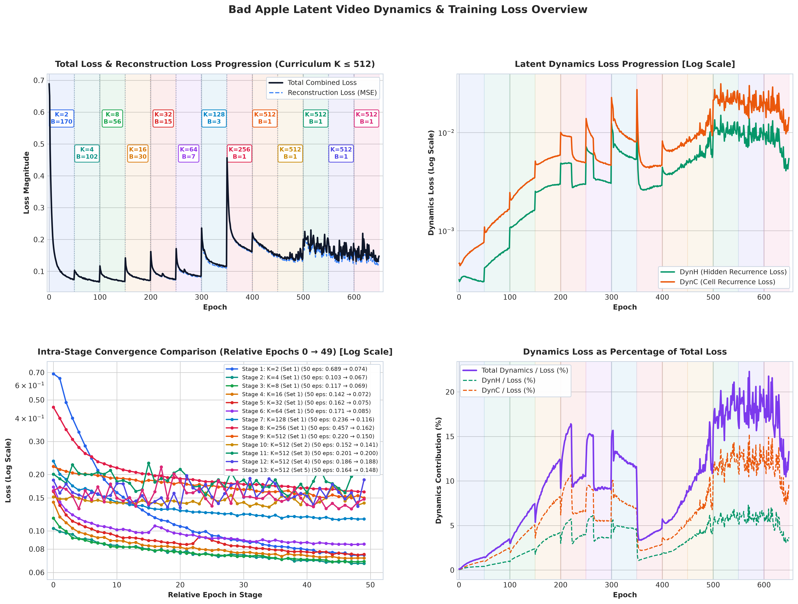
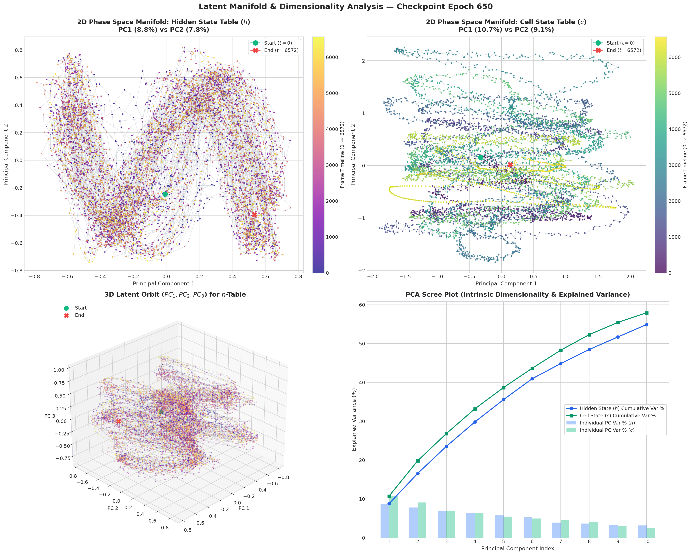

# Autonomous Neural Video Synthesis: Bad Apple!! as a Latent Dynamical System

This project investigates whether a compact neural network can learn an entire video as a **fully autonomous nonlinear dynamical system** that unrolls temporally in a low-dimensional latent space from a single initial condition.

The benchmark video is the complete [Bad Apple!! PV](https://www.youtube.com/watch?v=FtutLA63Cp8): **6,573 frames at 384×512 resolution (30 FPS, ~3m 39s)**.

---

## Motivation

This experiment was inspired by the work on [memorizing Bad Apple into a 3MB SIREN MLP](https://www.reddit.com/r/MachineLearning/comments/1vfrco1/i_compressed_bad_apple_into_a_3mb_neural_network_p/) ([GitHub: SlothScript/BadAppleOnANeuralNetwork](https://github.com/SlothScript/BadAppleOnANeuralNetwork)), which mapped coordinate queries $(t, y, x) \to \text{pixel}$ using periodic sine activations.

Instead of querying a spatial-temporal coordinate function with an explicit time index $t$, this project poses a different question:

> **Can a tiny recurrent transition network learn the continuous temporal flow of the video, such that evaluating $(h_0, c_0)$ autonomously generates all 6,573 frames without ever supplying the time index $t$ at inference time?**

```text
At Inference (Zero Timestamp Input):

  ┌──────────────┐   (h_t, c_t)   ┌──────────────────────┐   (h_{t+1}, c_{t+1})
  │ Initial State│───────────────>│ Recurrent Transition │──────────────────────> ...
  │   (h0, c0)   │                │   Function (CTF)     │
  └──────────────┘                └──────────────────────┘
                                              │
                                             h_t
                                              ▼
                                  ┌──────────────────────┐
                                  │    Frame Decoder     │───> Frame_t (384×512)
                                  └──────────────────────┘
```

---

## Inference Specifications & Resource Footprint

During inference, the learned table embeddings and optimizer states are completely discarded. The standalone inference package consists strictly of:
1. **Initial Latent Vectors**: $h_0 \in \mathbb{R}^{64}, c_0 \in \mathbb{R}^{64}$ ($128$ floats).
2. **Custom Transition Function (`ctf`)**: 4-gate LSTM-style recurrence ($16,640$ parameters).
3. **Frame Decoder (`fd`)**: 4-stage bilinear upsampling with depthwise-separable convolutions ($400,361$ parameters).

### 1. Parameter Breakdown

| Component | Layer Description | Parameters | Memory (FP32) |
| :--- | :--- | :---: | :---: |
| **Transition Function (`ctf`)** | Recurrent gates ($W_{hf}, W_{hi}, W_{ho}, W_{hg}$) | 16,640 | 65.00 KB |
| **Frame Decoder (`fd`)** | Latent projection ($64 \to 6144$) | 399,360 | 1,560.00 KB |
| | Conv Block 1 ($8 \to 16$, $3\times3$ Depthwise-Separable) | 232 | 0.91 KB |
| | Conv Block 2 ($16 \to 16$, $3\times3$ Depthwise-Separable) | 448 | 1.75 KB |
| | Conv Block 3 ($16 \to 8$, $3\times3$ Depthwise-Separable) | 312 | 1.22 KB |
| | Output Conv ($8 \to 1$, $1\times1$) | 9 | 0.04 KB |
| **Initial Latents ($h_0, c_0$)** | 64-dim initial hidden and cell vectors | 128 | 0.50 KB |
| **Total Inference Model** | | **417,129** | **1.60 MB** |

### 2. Runtime GPU Profiling (CUDA, `torch.no_grad()`)

- **Model Weights in VRAM**: **1.60 MB**
- **Peak Active VRAM (per frame decode)**: **17.22 MB**
- **Inference Throughput**: **>200 FPS** (on RTX 4080)
- **Standalone Package File**: `exports/models/bad_apple_inference_only.pt` (**1.60 MB**)

*(Note: The source MP4 is ~19.5 MB. This project is an investigation into neural memorization and nonlinear dynamical systems rather than a replacement for standardized entropy-coded video compression algorithms like H.264/AV1).*

---

## System Architecture

```text
Training Setup:

               ┌────────────────────────────────────────────────────────┐
               │    TrainingTableEmbeddings (Learned Anchor Scaffolding)│
               │         h_table: [6573, 64]   c_table: [6573, 64]      │
               └────────────────────────────────────────────────────────┘
                                    │               ▲
                         t_start    │               │  Supervision:
                                    ▼               │  L_dyn_h, L_dyn_c, L_smooth
                          (h_t, c_t) + Noise        │
                                    │               │
                                    ▼               │
                      ┌───────────────────────────┐ │
                      │CustomTransitionFunction   │─┘
                      │(Orthogonal Init + Gating) │
                      └───────────────────────────┘
                                    │
                                    │ h_t, h_{t+1}, ..., h_{t+K}
                                    ▼
                      ┌───────────────────────────┐
                      │FrameDecoder (Chunked = 32)│───> L_recon vs Ground Truth Frames
                      └───────────────────────────┘
```

### Key Components

1. **Two-State Recurrence ($h_t, c_t$)**:
   The decoder only receives $h_t$. The second state $c_t$ serves as an internal memory manifold, allowing the system to disambiguate identical video frames that occur at different timestamps.
2. **Learned Temporal Scaffolding (`TrainingTableEmbeddings`)**:
   Backpropagating end-to-end through 6,573 steps from epoch 1 is computationally intractable and suffers from severe gradient vanishing/exploding. Learned latent tables provide local initializations $(h_t, c_t)$ at arbitrary timestamps, allowing parallel randomized segment training.
3. **Hybrid Optimization (AdamW + Muon)**:
   - **AdamW** ($\text{LR} = 1\times 10^{-5}, \text{weight decay} = 10^{-3}$) optimizes the frame decoder and embedding tables.
   - **Muon** ($\text{LR} = 5\times 10^{-3}, \text{momentum} = 0.95$) optimizes the recurrent gate matrices $W_h$ using matrix orthogonalization.

---

## Training Methodology & Key Engineering Solutions

The primary obstacle in autonomous rollout is **compounding error**: microscopic transition errors at step $t$ shift the latent state away from the learned manifold, leading to visual divergence over long horizons. The system evolved through specific countermeasures:

```text
Curriculum Horizon (K=2 → 512)
       ├── Optimizer Momentum Attenuation (×0.2 every 10 epochs)
       ├── State Perturbation Injection (σ = 0.005)
       ├── Second-Difference Temporal Smoothness (Acceleration Regularization)
       └── Chunked Decoding (Chunk Size = 32)
```

### 1. Progressive Horizon Curriculum
Training begins with short local steps ($K=2$) and doubles systematically:

$$
K \in \{2, 4, 8, 16, 32, 64, 128, 256, 512\}
$$

Every curriculum transition introduces a predictable jump in loss as the recurrent model is forced to maintain stability over larger unrolls before adapting.

### 2. State Perturbation Training
To prevent the model from learning a brittle 1D trajectory that fails when slightly perturbed, Gaussian noise ($\sigma = 0.005$) is added to the latent state input before each recurrent step:

$$
\hat{z}_{t+1} = F(z_t + \epsilon), \quad \epsilon \sim \mathcal{N}(0, \sigma^2 I)
$$

The loss is computed between clean predicted states and ground-truth table states. This trains the transition function $F$ to act as a contractive map that pulls nearby states back toward the valid trajectory.

### 3. Second-Difference Acceleration Regularization
Directly penalizing velocity ($\|h_{t+1} - h_t\|$) encourages the trajectory to freeze. Instead, we penalize the discrete second derivative (acceleration / jitter):

$$
\mathcal{L}_{\text{smooth}} = \frac{1}{K-1} \sum_{t} \left( \|h_{t+2} - 2h_{t+1} + h_t\|_2^2 + \|c_{t+2} - 2c_{t+1} + c_t\|_2^2 \right)
$$

This enforces a smooth trajectory across latent space without constraining speed.

### 4. Periodic Optimizer Momentum Attenuation
When the curriculum doubles the rollout horizon $K$, accumulated gradient momentum from shorter horizons can act as stale inertia. Every 10 epochs, momentum buffers in both AdamW and Muon are attenuated by a factor of $0.2$:

$$
m \leftarrow 0.2 \times m
$$

### 5. Final Composite Loss Objective

$$
\mathcal{L}_{\text{total}} = 1.0 \cdot \mathcal{L}_{\text{dyn}, h} + 1.0 \cdot \mathcal{L}_{\text{dyn}, c} + \mathcal{L}_{\text{smooth}} + 0.2 \cdot \mathcal{L}_{\text{recon}}
$$

---

## Experimental Observations

- **Training Loss vs. Autonomous Rollout**:
  Selecting checkpoints based solely on the lowest training loss is misleading because training loss is measured with teacher-table anchors over finite horizons $K$. Model checkpoints were selected by evaluating full unrolls from $(h_0, c_0)$.
- **Checkpoint Optimizer-State Handling**:
  In early runs prior to epoch ~300, optimizer states were not retained across manual pauses. This caused accidental optimizer resets during some stage transitions. Once identified, intentional soft momentum attenuation ($\times 0.2$) was implemented cleanly.

---

## Visual Analytics & Latent Dynamics

### 1. Training Convergence & Curriculum Progression
<p align="center">
  
</p>

### 2. Latent Phase Space & Manifold Geometry (PCA 2D / 3D)
<p align="center">
  
</p>

*(Additional analytics dashboards—including stage-by-stage convergence grids, cosine self-similarity recurrence matrices, step velocities, and a standalone interactive Three.js 3D point cloud visualizer—are available in [`exports/plots/`](exports/plots/) and [`exports/interactive/`](exports/interactive/)).*

---

## Repository Structure

```text
├── exports/
│   ├── export_pipeline.py    # Generates packaged models, CSV/JSON tables, and plots
│   ├── load_and_rollout.py   # Self-contained video synthesis and evaluation engine
│   ├── models/
│   │   ├── bad_apple_inference_only.pt       # Standalone 1.60 MB inference package
│   │   └── bad_apple_complete_training.pt    # Complete checkpoint with optimizer states
│   ├── plots/                # High-resolution analytics dashboards
│   ├── tables/               # CSV/JSON training metrics and parameter statistics
│   └── interactive/          # Standalone WebGL 3D latent point cloud visualizer
├── extract_frames.py         # FFmpeg frame extraction utility
├── visualize_tables.py       # Latent manifold, PCA, recurrence, and gating visualizers
├── logs.txt                  # Full 650-epoch training log
└── README.md
```

---

## Quickstart & Usage

### 1. Requirements

```bash
git clone https://github.com/SEBADA321/BadAppleRNN.git
cd BadAppleRNN
python -m venv .venv
source .venv/bin/activate
pip install torch torchvision numpy opencv-python matplotlib
```

### 2. Run Autonomous Video Rollout

Generate a side-by-side video comparing ground truth against autonomous unroll with real-time MSE and timestamp overlays:

```bash
python exports/load_and_rollout.py
```
*(Outputs `exports/rollout_side_by_side.mp4`)*

#### Optional Presentation Modes:
```bash
# Tri-Panel: Ground Truth | Table Reconstruction | Autonomous Rollout
python exports/load_and_rollout.py --mode tri-panel

# Clean Single-Stream Autonomous Video (512x384)
python exports/load_and_rollout.py --mode single

# Direct Table Reconstruction Comparison
python exports/load_and_rollout.py --mode table
```

### 3. Re-generate All Export Artifacts & Analytics

To package checkpoints, parse logs, generate tables, and re-create publication dashboards:

```bash
python exports/export_pipeline.py
```

---

## Citation & References

- [Bad Apple on a Neural Network (SIREN INR by SlothScript)](https://github.com/SlothScript/BadAppleOnANeuralNetwork)
- Sitzmann et al., *"Implicit Neural Representations with Periodic Activation Functions"*, NeurIPS 2020.
- Jordan et al., *"Muon: An optimizer for hidden layers in neural networks"*, 2024.
